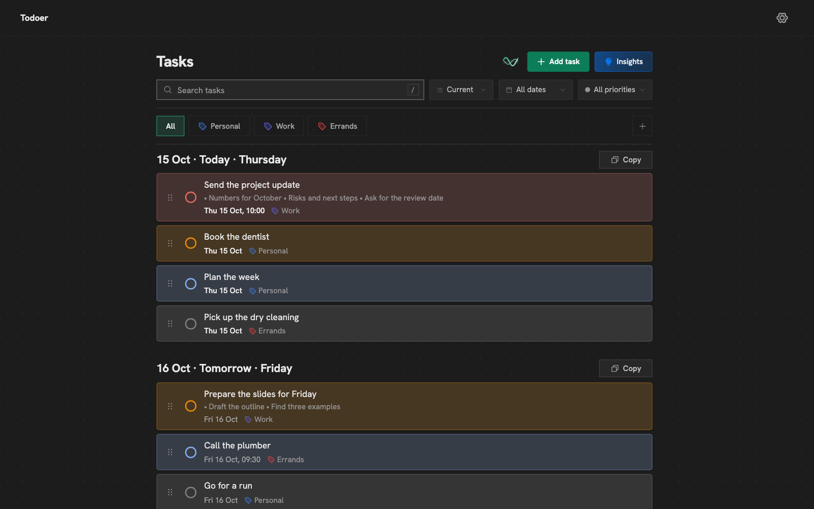

# Todoer

A to-do list with goals, priorities and drag to plan your days. It runs on your computer, and your tasks live in your own free Supabase project. Nothing goes to anyone else's server unless you turn on [Ramble](#ramble).



- **Goals and priorities.** File tasks under goals, each with one of four priorities. Each day lists the most important first.
- **Plan by dragging** a task within its day or onto another. Overdue tasks wait in their own box.
- **Descriptions with lists**, as in Notes.
- **Search** that finds every word you type, in any order.
- **Insights**: what you add, by goal, from a week to five years.
- **Copy a day** as a list for WhatsApp, Notes or email.
- **Ramble:** say your tasks, check them, add them.
- **Nine themes**, and it works on a phone.

Free to use and change for yourself ([Licence](#licence)). To work on the code, see [CONTRIBUTING.md](CONTRIBUTING.md).

## Install

You need a Mac, Windows or Linux computer, [Node.js](https://nodejs.org) (the LTS version), and a free [Supabase](https://supabase.com) account (no card). It takes about ten minutes, once.

On Windows, leave Node's "Automatically install the necessary tools" box unticked: Todoer doesn't need them.

### With publik

Open [Todoer on publik](https://publikhq.com/todoer) and follow its steps.

### Download

Paste one line into **Terminal** (Mac or Linux) or **Command Prompt** (Windows, not PowerShell). It downloads 6 MB, makes a `todoer` folder where you are, and opens Todoer in your browser a few seconds later.

Mac and Linux:

```bash
curl -fsSL https://github.com/emehta/todoer/releases/latest/download/todoer.zip -o todoer.zip && unzip -q todoer.zip && rm todoer.zip && cd todoer && npm start
```

Windows:

```bat
curl -fsSL https://github.com/emehta/todoer/releases/latest/download/todoer.zip -o todoer.zip && tar -xf todoer.zip && del todoer.zip && cd todoer && npm start
```

### With Git

```bash
git clone https://github.com/emehta/todoer.git && cd todoer && npm install && npm start
```

This builds Todoer on your computer first, which takes about a minute.

Either way, Todoer opens at **http://localhost:3101**. Keep the window that started it open: closing it stops Todoer.

## Connect Supabase

Todoer's first screen, **Set up Todoer**, walks you through it:

1. **Make a project.** Sign in at [supabase.com](https://supabase.com/dashboard/projects) (a new account first asks you to name an organisation: any name, Free plan). On **Create a new project**, choose a name, a database password and the region nearest you, then press **Create new project**.
2. **Copy the Project URL** from the project's home page (**Copy** beside the address under its name) into Todoer.
3. **Copy both keys** from **API Keys**: the **Publishable key** (`sb_publishable_`) and the one under **Secret keys** (`sb_secret_`; press the eye to show it). Press **Connect**.
4. **Add the tables.** Press **Copy the setup**, open the **SQL Editor** (if Supabase shows a note about snippets, press **Understood**), paste, press **Run**, then **Check again** in Todoer.
5. **Make your account.** You start with two goals, Personal and Work.

Then switch off sign-ups, so the project stays yours: in Supabase, **Authentication**, **Sign In / Providers**, switch off **Allow new users to sign up**, then **Save changes**. Strangers could see none of your tasks anyway; Settings reminds you until it's off.

Leave **Enable Data API** on (**Integrations**, **Data API**): Todoer talks to your project through it.

The secret key is saved only on your computer, in a file only your account can read:

- Mac: `~/Library/Application Support/Todoer`
- Windows: `%LOCALAPPDATA%\Todoer`
- Linux: `~/.config/todoer`

## Ramble

The waves button beside **Add task**: talk, and Todoer writes it as tasks for you to check. Choose what listens in **Settings**, under **Ramble**:

- **Groq**: free, with your own key from [console.groq.com](https://console.groq.com/keys). Paste it and press **Save**; Todoer checks it first. The free plan has limits per minute and per day, and no bill.
- **publik**: no key. Press **Accept and use publik**, then **Sign in with publik** to link this computer for $0.05 of free use. After that it's paid per use; a short ramble costs about a fifth of a cent.

The recording goes to the one you chose to be written down and read. Todoer keeps neither the recording nor the words. The first time, allow the microphone for `localhost`.

## Open it again

Double-click **Start Todoer.command** (Mac) or **Start Todoer.cmd** (Windows) in the `todoer` folder. It opens Todoer, or the copy already running.

To open it like an app: Safari's **File → Add to Dock**, or Chrome's **Install** icon in the address bar.

## Your data

- **Back up** with Settings → **Download my data**: every goal and task in one file. Supabase's free plan keeps no backups, so do it now and then. Todoer can't read the file back in yet.
- **A paused project:** Supabase pauses a free project after a week unused. Press **Restore project** there, then **Try again** in Todoer.
- **Another project:** stop Todoer, delete `config.json` from the folder above, and start it again. Your tasks stay in the old project.

## Update

Close Todoer's window first. Your tasks and settings are kept.

- **Downloaded:** delete the `todoer` folder (`rm -rf todoer` on Mac or Linux, `rmdir /s /q todoer` on Windows), then run the download line again.
- **With publik or Git:** in the `todoer` folder, run `git checkout main && git pull && npm install && npm start`.

If an update changes the tables, Todoer asks you to run the setup again. Nothing is lost.

## Something not working

- **"Supabase isn't answering":** check you're online, and that the project isn't [paused](#your-data).
- **"Another program is using port 3101":** start on another port with `npm start -- --port 3105`.
- **Forgot your password:** press **Forgot password?** on the sign-in screen and paste your project's secret key.
- **Windows says npm isn't recognised:** open a new Command Prompt after installing Node.
- **PowerShell says "running scripts is disabled":** use Command Prompt, or type `npm.cmd` for `npm`.
- **The microphone is blocked:** allow it for `localhost` in the browser's site settings (left of the address bar), then reload.

## Remove it

1. Delete the `todoer` folder, and the settings folder [above](#connect-supabase). If you used publik, also delete its key for Todoer, `publik/apps/todoer.json`, in the same place as that folder (Application Support, `%LOCALAPPDATA%` or `~/.config`).
2. If you added it like an app: delete Safari's from the **Applications** folder in your home folder, or open Chrome's and choose **Uninstall Todoer** from its ⋮ menu.
3. If you're done with Supabase, delete the project there.

## Licence

[PolyForm Noncommercial 1.0.0](LICENSE.md): use it, change it and share it for yourself or any non-commercial purpose. Don't sell it or use it in a business.

Copyright Eshaan Mehta.
